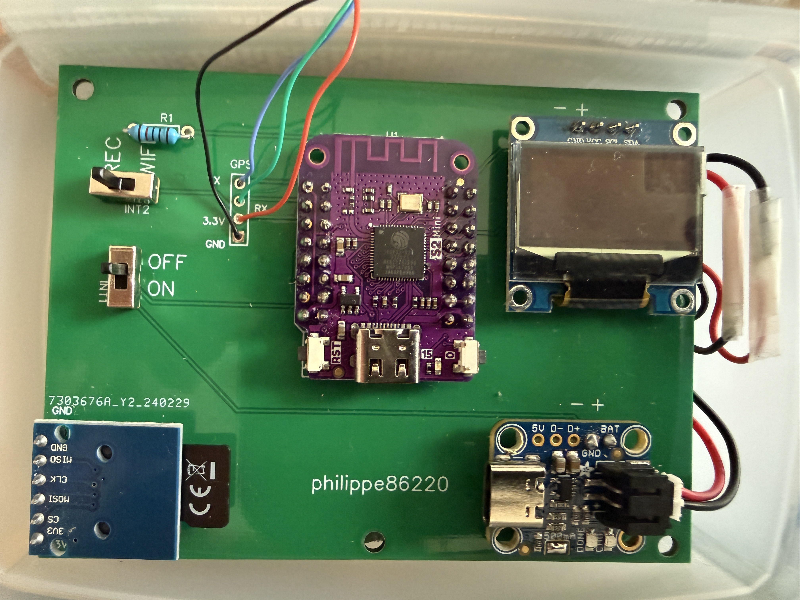
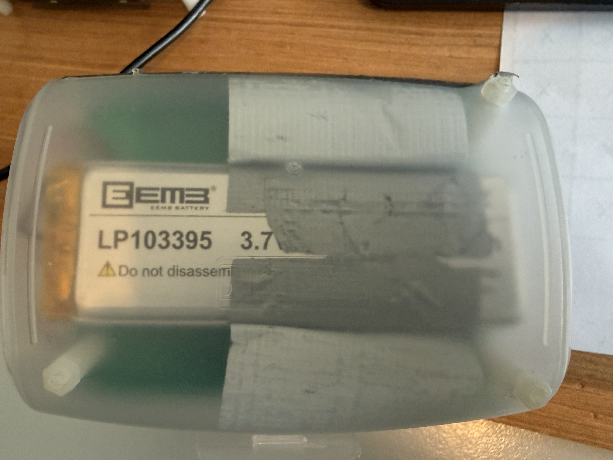
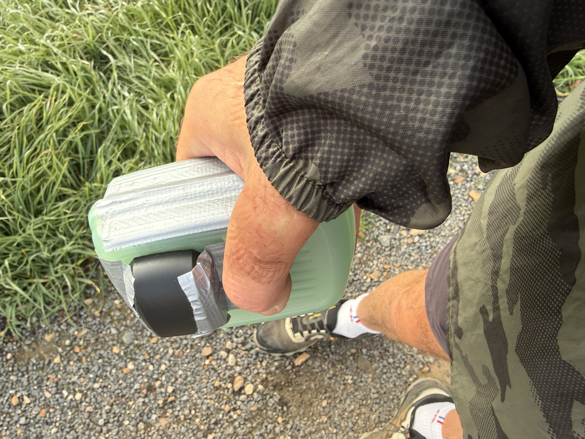
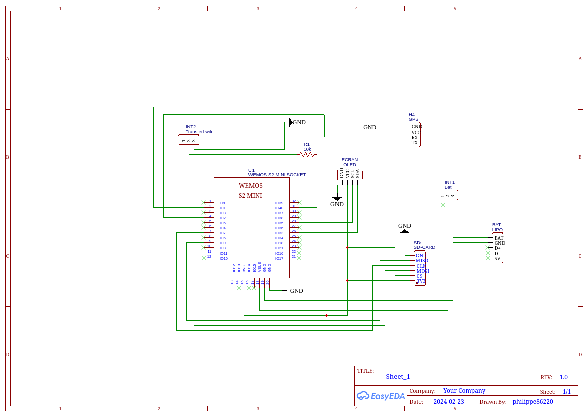
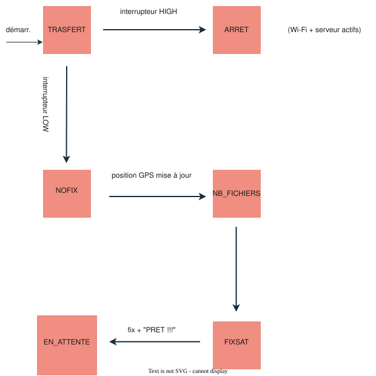

# Enregistreur GPS → fichiers GPX (LOLIN S2 mini)

Enregistreur de traces GPS autonome basé sur un **LOLIN (Wemos) S2 mini** (ESP32-S2) avec module pour carte micro SD.
Il enregistre la position toutes les 1,5 s dans des fichiers **GPX 1.1** sur carte SD, affiche le chrono sur un écran OLED, et permet de **récupérer la dernière trace par Wi-Fi** grâce à un petit serveur web.

---

## Quelques photos 

 

 

 


## Fonctionnalités

- Enregistrement des points GPS (latitude, longitude, altitude, heure, nombre de satellites, HDOP) dans un fichier `trackXXX.gpx`.
- Démarrage / arrêt de l'enregistrement avec un bouton (le bouton `0` de la carte).
- Affichage OLED : message « PRET !!! » quand le fix GPS est obtenu, puis durée écoulée (h, min, s) et nom du fichier en cours.
- **Deux modes** sélectionnés par un interrupteur : mode **GPS** (enregistrement) et mode **transfert** (Wi-Fi + serveur web).
- Rotation automatique : au plus **200 fichiers** (`track000.gpx` à `track199.gpx`), le plus ancien est écrasé ensuite.
- Gestion automatique de l'heure d'été française (calcul sans module RTC).
- Adresse IP statique en mode transfert.

---

## Matériel

| Élément                 | Détail                                                                                                                                         |
| ----------------------- | ---------------------------------------------------------------------------------------------------------------------------------------------- |
| Carte                   | LOLIN S2 mini V1.0.0 (ESP32-S2)                                                                                                                |
| Stockage                | Lecteur de carte micro SD                                                                                                                      |
| GPS                     | Module GPS série (NMEA, 9600 bauds)                                                                                                            |
| Écran                   | OLED SSD1306 128×64, I2C, adresse `0x3C`                                                                                                       |
| Bouton                  | Bouton intégré de la carte, le bouton `0`                                                                                                      |
| Interrupteur REC - WIFI | Interrupteur coulissant à 2 positions + résistance 10 kΩ                                                                                       |
| Interrupteur ON - OFF   | Interrupteur coulissant à 2 positions                                                                                                          |
| module de charge LiPo   | Adafruit Micro-Lipo Charger for LiPoly Batt with USB Type C Jack  (Attention à la polarité parfois inversée avec le connecteur de la batterie) |
| batterie LIPO           | 3.7V - 3700mAh - 13.7Wh                                                                                                                        |

---

## schéma

 

---

## Câblage et brochage

### Ports de la carte

```
Série GPS (SoftwareSerial) : RX = GPIO 1, TX = GPIO 2

I2C (écran OLED)  : SDA = GPIO 33, SCL = GPIO 35

SPI (carte SD)    : SS (CS) = GPIO 12
                    MOSI    = GPIO 11
                    MISO    = GPIO 9
                    SCK     = GPIO 7

Bouton start/stop : GPIO 0  (INPUT_PULLUP, actif à l'état bas)
Interrupteur mode : GPIO 40 (INPUT)
```

### Interrupteur de mode (GPIO 40)

L'interrupteur INT2 est un inverseur (SPDT). Son point commun est relié à GPIO 40 par une résistance R1 de 10 kΩ en série. Ses deux autres bornes sont reliées l'une au GND, l'autre au 3,3 V. 

```
              ┌── 3,3 V
INT2 (inv.) ──┤
   commun     └── GND
     │
   R1 10 kΩ (série, protection)
     │
  GPIO 40
```

| État de GPIO 40   | Position de l'interrupteur	:      Mode          |
| ----------------- | ----------------------------------------------- |
| `HIGH` côté 3,3 V | **Transfert** : Wi-Fi activé, serveur web actif |
| `LOW`   côté GND  | **GPS** : Wi-Fi non activé, enregistrement possible  |

### GPS

Le **TX du module GPS** se connecte sur la broche **RX (GPIO 1)** de la carte, et le **RX du module**  sur **GPIO 2** (non utilisé en pratique, le GPS n'est qu'écouté).

---

## Bibliothèques nécessaires

À installer dans l'IDE Arduino (gestionnaire de bibliothèques ou archive ZIP) :

- `WiFi` (incluse avec le support ESP32)
- [`ESPAsyncWebServer`](https://github.com/me-no-dev/ESPAsyncWebServer) (et sa dépendance `AsyncTCP`)
- `SoftwareSerial` (version ESP32, ex. *EspSoftwareSerial*)
- [`TinyGPSPlus`](https://github.com/mikalhart/TinyGPSPlus)
- `SD` (incluse avec le support ESP32)
- `Wire` (incluse)
- `Adafruit GFX Library`
- `Adafruit SSD1306`

Carte à sélectionner : **LOLIN S2 Mini** (paquet « esp32 » d'Espressif).

---

## Utilisation

### Enregistrer une trace

1. Placer l'interrupteur `INT2` en position **REC** (GPIO 40 au niveau bas).
2. Mettre sous tension la carte. Interrupteur `INT1` sur **ON**.
3. Attendre le fix GPS : l'écran affiche **PRET !!!**.
4. Appuyer sur le `bouton 0` de la carte : l'enregistrement démarre. L'écran affiche le chrono et le nom du fichier (ex. `/track012.gpx`).
5. Appuyer à nouveau sur le `bouton 0` : l'enregistrement s'arrête, le fichier GPX est refermé proprement et l'écran affiche **STOP ...**.

Il est possible de relancer un nouvel enregistrement (nouveau fichier) sans redémarrer mais il vaut mieux mettre la carte hors tension en plaçant  `INT1` sur **OFF**. C'est toujours le dernier ficchier `GPX` qui est téléchargé mais il vous est possible de retirer la carte SD du lecteur pour récupérer plusieurs traces.

### Récupérer la dernière trace

1. Placer l'interrupteur en position **transfert** (GPIO 40 au niveau haut) **avant la mise sous tension** (l'état est lu uniquement au démarrage).

2. Mettre sous tension la carte. Interrupteur `INT1` sur **ON**.

3. La carte se connecte au Wi-Fi puis sert la dernière trace à l'adresse IP configurée (voir Serveur web). 

4. Sous Linux ouvrez un terminal et tapez :
   `curl -o trace.gpx http://IP_STATIQUE/interpret`

5. Vous retrouvez votre trace `GPX` dans votre dossier personnel sous le nom : `trace.gpx`. A chaque téléversement ce fichier est écrasé dans ce dossier.

6. Vous pouvez importer ce fichier dans une application de sport en ligne  comme : [https://www.decathloncoach.com/fr-fr/portal/feed]()

---

## Fonctionnement du programme

Le programme est organisé autour d'une **machine à états** (`etatCourant`) :





| État          | Rôle                                                                                               |
|:------------- | -------------------------------------------------------------------------------------------------- |
| `TRANSFERT`   | État initial : lit l'interrupteur et choisit le mode.                                              |
| `ARRET`       | Mode transfert : le serveur tourne, plus rien à faire dans `loop()`.                               |
| `NOFIX`       | Attend une première position GPS valide.                                                           |
| `NB_FICHIERS` | Vérifie si `/nb.txt` existe (rotation déjà atteinte) et relit le numéro du fichier le plus ancien. |
| `FIXSAT`      | Affiche « PRET !!! » dès le fix, calcule le décalage d'heure d'été (`heures`).                     |
| `EN_ATTENTE`  | État permanent : gère le bouton, l'enregistrement des points et la fermeture du fichier.           |

### Boucle d'enregistrement (`EN_ATTENTE`)

- **Bouton appuyé** (avec anti-rebond de 100 ms avant et après, et attente du relâchement) :
  - si l'enregistrement est arrêté : choix d'un nom de fichier libre (`/trackXXX.gpx`), remise à zéro du chrono, écriture de l'en-tête GPX, `b_gpx_tracking = true` ;
  - sinon : `b_gpx_tracking = false` (arrêt demandé).
- **Toutes les 1,5 s** (si des données série GPS sont disponibles) :
  - si l'enregistrement est actif et la position mise à jour → mise à jour de l'écran et ajout d'un `<trkpt>` ;
  - si l'enregistrement vient d'être arrêté → écriture de la fin du GPX (`completeGPX()`), et, si la rotation est active, mise à jour de `/nb.txt`.

Les trames GPS ne sont lues (`gps.encode`) que lorsque l'interrupteur est en position GPS.

---

## Format des fichiers GPX

Chaque fichier respecte la structure GPX 1.1 :

```xml
<?xml version="1.0" encoding="UTF-8" standalone="no" ?>
<gpx version="1.1" creator="P. COSTES" xmlns="http://www.topografix.com/GPX/1/1" ...>
  <metadata>
    <name>/track012.gpx</name>
    <desc>Wemos S2 mini - GPS_S2_ mini</desc>
    <author><name>P. COSTES</name></author>
  </metadata>
  <trk>
    <name>/track012.gpx</name>
    <desc>Wemos S2 mini</desc>
    <trkseg>
      <trkpt lat="48.12345678" lon="2.12345678">
        <ele>85.20</ele>
        <time>2026-11-09T10:30:20+01:00</time>
        <sat>8</sat>
        <hdop>110</hdop>
      </trkpt>
      ...
    </trkseg>
  </trk>
</gpx>
```

- `lat` / `lon` : 8 décimales.
- `ele` : altitude en mètres.
- `time` : date et heure construites à partir du GPS, **heure locale** (UTC + `heures`).
- `sat` : nombre de satellites.
- `hdop` : précision horizontale brute fournie par TinyGPSPlus (valeur ×100).

  
Les points sont ajoutés un par un (ouverture en `FILE_APPEND`, écriture, fermeture), Cette méthode limite les pertes de données en cas de coupure d'alimentation. Toutefois, une interruption pendant l'enregistrement peut laisser le fichier GPX incomplet, notamment en raison de l'absence des balises XML de fermeture.

---

## Gestion et rotation des fichiers GPX

L'enregistreur conserve un maximum de **200 fichiers GPX** sur la carte SD, numérotés de `track000.gpx` à `track199.gpx`.

Lorsque cette limite est atteinte, les nouveaux enregistrements remplacent progressivement les plus anciens selon un principe de **rotation circulaire**.

### 1. Création des fichiers

Sur une carte SD initialement vide, les fichiers sont créés successivement :

`track000.gpx` → `track001.gpx` → ... → `track199.gpx`

Chaque nouvel enregistrement utilise le premier numéro disponible.

Tant que la limite de 200 fichiers n'est pas atteinte, aucun fichier GPX n'est supprimé.

### 2. Rotation des fichiers

Lorsque les 200 emplacements sont occupés, le prochain enregistrement entraîne :

1. La suppression de `track000.gpx`, le plus ancien fichier.
2. La création d'un nouveau `track000.gpx`.
3. L'activation de la rotation circulaire.

Les enregistrements suivants remplacent successivement :

`track001.gpx` → `track002.gpx` → ... → `track199.gpx`

Une fois `track199.gpx` remplacé, le programme revient à `track000.gpx`.

**Le nombre de fichiers GPX présents sur la carte SD ne dépasse donc pas 200 dans les conditions normales d'utilisation.**

### 3. Rôle du fichier `nb.txt`

Le fichier `/nb.txt` permet de conserver le numéro du dernier enregistrement lorsque la rotation est active.

Son fonctionnement est le suivant :

- **Fichier absent :** le programme recherche le premier numéro GPX disponible.
- **Fichier présent :** le programme lit le dernier numéro enregistré afin de poursuivre la rotation à partir de celui-ci.

Le fichier `nb.txt` est créé lorsque la rotation devient active, puis actualisé à la fermeture de chaque nouvel enregistrement.

Il permet ainsi de retrouver la position de la rotation après une coupure d'alimentation.

### 4. Gestion des redémarrages

L'enregistreur peut être éteint après chaque séance, puis redémarré ultérieurement.

Deux situations sont prises en charge :

**Avant la première rotation**

Si `/nb.txt` n'existe pas, le programme parcourt les noms des fichiers GPX présents sur la carte SD pour trouver le premier emplacement disponible.

Si les 200 fichiers existent déjà, il active automatiquement la rotation, supprime `track000.gpx` et réutilise ce numéro.

**Après activation de la rotation**

Si `/nb.txt` existe, le programme récupère le numéro du dernier fichier enregistré et détermine le prochain emplacement à réutiliser.

La rotation peut ainsi se poursuivre après chaque redémarrage, sans intervention de l'utilisateur.

---

### 5. Transfert des fichiers

En mode Wi-Fi, le programme détermine le dernier fichier GPX enregistré :

- Si `/nb.txt` existe, son contenu indique directement le numéro du dernier fichier.
- Sinon, le programme recherche le dernier fichier de la séquence initiale.

Le fichier sélectionné est alors accessible depuis le serveur web de l'enregistreur.

### Conditions d'utilisation

Ce mécanisme suppose que les fichiers GPX sont conservés sur la carte SD sans suppression ou renommage individuel.

Pour réinitialiser complètement la numérotation, il suffit de supprimer tous les fichiers `trackXXX.gpx` ainsi que le fichier `/nb.txt`.

Au prochain démarrage, l'enregistrement reprend à `track000.gpx`.

---

## Serveur web

En mode transfert, la carte se connecte au Wi-Fi avec l'adresse IP statique et démarre un `AsyncWebServer` sur le **port 80** :

| URL                             | Comportement                                                                                                |
| ------------------------------- | ----------------------------------------------------------------------------------------------------------- |
| `http://IP_STATIQUE/`          | **Télécharge** la dernière trace (`Content-Disposition: attachment`)                                        |
| `http://IP_STATIQUE/interpret` | Sert la trace en `text/xml` **sans** forcer le téléchargement (affichage ou traitement par une application) |

---

## Fonction `initReseauWifi()` : Wi-Fi, IP statique et serveur web

Cette fonction est appelée **une seule fois**, au démarrage, quand l'interrupteur est en position **transfert** (GPIO 40 au niveau haut). Elle choisit le fichier à servir (le dernier enregistré), connecte la carte au Wi-Fi, affiche l'état sur l'écran OLED et démarre le serveur web qui permet de récupérer la dernière trace GPX.

---

## 1. Où elle intervient dans le programme

```cpp
case TRANSFERT:
  if (digitalRead(pinInterrupteur) == HIGH) {
    initReseauWifi();
    etatCourant = ARRET;      // la machine à états ne bouge plus ensuite
  }
```

- Après l'appel, la machine passe en `ARRET` : le serveur tourne en tâche de fond (bibliothèque asynchrone) et `loop()` n'a plus rien à faire.
- Pour quitter ce mode, on coupe l'alimentation et on remet l'interrupteur en position GPS.

---

## 2. Déroulement pas à pas

### Étape 1 : choisir le fichier à servir

```cpp
if (isnNbTxt()) {
  const char* s = fichierLePlusVieux_L();
  fileID = s ? atoi(s) : 0;
  sprintf(GPXFILE, "/track%03d.gpx", fileID);
}
else if (!isnNbTxt()) {
  while (1) {
    sprintf(GPXFILE, "/track%03d.gpx", fileID);
    if (!SD.exists(GPXFILE)) break;
    else fileID++;
  }
  sprintf(GPXFILE, "/track%03d.gpx", fileID - 1);
}
```

| Situation | Fichier servi |
|---|---|
| `nb.txt` existe (rotation active) | le numéro lu dans `nb.txt`, c'est-à-dire le dernier fichier enregistré |
| `nb.txt` n'existe pas (cycle 1) | le dernier fichier existant : on cherche le premier numéro libre, puis on recule de 1 |

Le résultat est stocké dans `GPXFILE`, que les routes du serveur utilisent plus bas.

### Étape 2 : configurer le Wi-Fi

```cpp
WiFi.persistent(false);
WiFi.mode(WIFI_STA);
bool ipStatiqueOK = WiFi.config(local_IP, gateway, subnet);
WiFi.begin(ssid, password);
```

- **`WiFi.persistent(false)`** : empêche l'ESP32 d'écrire le nom du réseau et le mot de passe dans sa mémoire flash à chaque connexion.
- **`WiFi.mode(WIFI_STA)`** : place la carte en mode station (voir le tableau plus bas).
- **`WiFi.config(...)`** : demande une adresse IP fixe. Elle doit être appelée **avant** `WiFi.begin()`. Le résultat (`true` ou `false`) est mémorisé dans `ipStatiqueOK`.
- **`WiFi.begin(...)`** : lance la connexion au réseau.

### Étape 3 : attendre la connexion (20 s maximum)

```cpp
unsigned long debut = millis();
while (WiFi.status() != WL_CONNECTED && millis() - debut < 20000) {
  delay(500);
}
```

La connexion prend quelques secondes. Sans cette attente, le test qui suit serait toujours négatif. La boucle s'arrête dès que la carte est connectée, ou au bout de 20 secondes.

### Étape 4 : tester le résultat et afficher l'état

| Écran | Signification |
|---|---|
| `WIFI...` | connexion en cours |
| `WIFI KO` | pas de connexion après 20 s. La fonction se termine par `return` : **le serveur n'est pas démarré** |
| `WIFI OK` + 3 adresses | connecté avec l'adresse statique demandée |
| `IP STAT KO` + 3 adresses | connecté, mais `WiFi.config()` a échoué : la carte a reçu une adresse du DHCP |

Les trois lignes d'adresses sont : l'adresse de la carte, la passerelle (la box) et le masque de sous-réseau.

### Étape 5 : démarrer le serveur web

```cpp
server.on("/", HTTP_GET, [](AsyncWebServerRequest * request) {
  request->send(SD, GPXFILE, "text/xml", true);
});
server.on("/interpret", HTTP_GET, [](AsyncWebServerRequest * request) {
  request->send(SD, GPXFILE, "text/xml", false);
});
server.begin();
```

| Adresse | Comportement |
|---|---|
| `/` | télécharge le fichier (téléchargement forcé) |
| `/interpret` | sert le fichier en texte, sans forcer le téléchargement |

---

## 3. Les modes Wi-Fi de l'ESP32

| Mode | Rôle |
|---|---|
| `WIFI_STA` | **station** : la carte se connecte à votre box, comme un téléphone. C'est le mode utilisé ici |
| `WIFI_AP` | point d'accès : la carte crée son propre réseau |
| `WIFI_AP_STA` | les deux à la fois |
| `WIFI_OFF` | Wi-Fi coupé |

`WiFi.begin()` passe déjà la carte en mode station. La ligne `WiFi.mode(WIFI_STA)` rend simplement l'ordre explicite : le mode est réglé avant `WiFi.config()`. Elle est sans effet négatif.

---

## 4. L'affichage sur l'écran OLED

L'écran fait 128 × 64 pixels.

- **`setTextSize(2)`** : 12 pixels par caractère, donc **10 caractères par ligne** au maximum. Les messages doivent rester courts (`IP STAT KO` fait exactement 10 caractères).
- **`setTextSize(1, 2)`** : caractères étroits (6 pixels) mais deux fois plus hauts (16 pixels). Une adresse comme `192.168.1.254` tient sur une ligne.
- Quatre lignes de 16 pixels occupent les 64 pixels de l'écran, sans marge.
- La taille est remise à 2 à la fin pour ne pas perturber les autres affichages.

---

## 5. Récupérer la trace

1. Interrupteur en position transfert, puis mise sous tension.
2. Attendre que l'écran affiche `WIFI OK` (ou `IP STAT KO`) avec l'adresse de la carte.
3. Depuis l'ordinateur :

```bash
curl -o trace.gpx http://ADRESSE_DE_LA_CARTE/interpret
```

Utilisez l'adresse affichée à l'écran : c'est celle que la carte a réellement obtenue.

---

## Heure d'été / heure d'hiver

La fonction `RTCete()` détermine si la date UTC fournie par le GPS tombe en heure d'été en France métropolitaine, **sans module RTC** :

- passage à l'heure d'été : dernier dimanche de mars, 01h00 UTC ;
- retour à l'heure d'hiver : dernier dimanche d'octobre, 01h00 UTC.
- Le décalage horaire est calculé lors de l'obtention du fix GPS et reste constant pendant la session.

Le dernier dimanche est calculé par une formule arithmétique à partir de l'année sur deux chiffres. La fonction renvoie `true` (été, décalage +2 h) ou `false` (hiver, +1 h), et le résultat est stocké dans la variable `heures`, ajoutée à l'heure UTC dans chaque `<time>`.

---

## Référence des fonctions

| Fonction                        | Rôle                                                                                                                 |
| ------------------------------- | -------------------------------------------------------------------------------------------------------------------- |
| `setup()`                       | Initialise le GPS (9600 bauds), l'écran OLED, la carte SD, les entrées, et place la machine à états sur `TRANSFERT`. |
| `loop()`                        | Lit le GPS (mode GPS) et exécute la machine à états.                                                                 |
| `initGPX()`                     | Crée le fichier GPX et écrit l'en-tête (XML, métadonnées, début de `<trkseg>`).                                      |
| `addTrackpt()`                  | Ajoute un `<trkpt>` avec position, altitude, heure, satellites et HDOP.                                              |
| `completeGPX()`                 | Affiche « STOP ... » et ferme les balises `</trkseg>`, `</trk>`, `</gpx>`.                                           |
| `initReseauWifi()`              | Détermine le dernier fichier, configure l'IP statique, se connecte au Wi-Fi, déclare les routes et lance le serveur. |
| `suppressionFichiers(int x)`    | Supprime `/trackXXX.gpx` s'il existe.                                                                                |
| `isnNbTxt()`                    | Indique si `/nb.txt` existe.                                                                                         |
| `fichierLePlusVieux_E(int nmr)` | Écrit le numéro dans `/nb.txt`.                                                                                      |
| `fichierLePlusVieux_L()`        | Lit `/nb.txt` et renvoie son contenu sous forme de chaîne (ou `nullptr`).                                            |
| `affiche()`                     | Met à jour l'OLED : durée écoulée depuis le début de la trace et nom du fichier.                                     |
| `RTCete(...)`                   | Renvoie `true` si la date UTC correspond à l'heure d'été française.                                                  |

---


## Auteur

 **Philippe COSTES** (Philippe86220)   
 Auteur de la fonction`RTCete(...)`  :  @bricoleau https://forum.arduino.cc/t/trouver-date-et-heure-changement-heure-ete-hiver/1250041/21  &rarr;
 pour sa comprehension c'est ici : https://forum.arduino.cc/t/jour-de-la-semaine-en-fonction-de-yy-mm-dd/1284802

## Remerciements

Un grand merci à **@j-m-l**, qui m'a accompagné dans mon apprentissage des bases du langage C++ et de nombreux autres concepts de programmation.

En 2022, il m'a notamment guidé lors de la conception d'une première version de cet enregistreur GPS :

[GPS avec création de fichiers GPX — version C-string](https://forum.arduino.cc/t/gps-avec-creation-de-fichiers-gpx-version-c-string/996413)

Je tiens particulièrement à le remercier pour sa patience, sa disponibilité et ses grandes qualités pédagogiques.

Mes remerciements vont également aux autres membres du forum Arduino francophone qui m'ont aidé à progresser au fil des années.

Enfin, merci à **ChatGPT (OpenAI)** pour son accompagnement dans l'analyse du code, la résolution de problèmes techniques et l'aide apportée à la rédaction de cette documentation.

 
