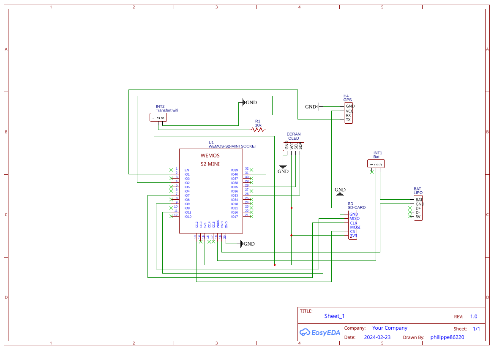

# Enregistreur GPS → fichiers GPX (LOLIN S2 mini)

Enregistreur de traces GPS autonome basé sur un **LOLIN (Wemos) S2 mini** (ESP32-S2) avec shield micro SD.
Il enregistre la position toutes les 1,5 s dans des fichiers **GPX 1.1** sur carte SD, affiche le chrono sur un écran OLED, et permet de **récupérer la dernière trace par Wi-Fi** grâce à un petit serveur web.

---

## Fonctionnalités

- Enregistrement des points GPS (latitude, longitude, altitude, heure, nombre de satellites, HDOP) dans un fichier `trackXXX.gpx`.
- Démarrage / arrêt de l'enregistrement avec un bouton (le bouton `0` de la carte).
- Affichage OLED : message « PRET !!! » quand le fix GPS est obtenu, puis durée écoulée (h, min, s) et nom du fichier en cours.
- **Deux modes** sélectionnés par un interrupteur : mode **GPS** (enregistrement) et mode **transfert** (Wi-Fi + serveur web).
- Rotation automatique : au plus **200 fichiers** (`track000.gpx` à `track199.gpx`), le plus ancien est écrasé ensuite.
- Gestion automatique de l'heure d'été française (calcul sans module RTC).
- Adresse IP statique en mode transfert.

---

## Matériel

| Élément                 | Détail                                                                                                                                         |
| ----------------------- | ---------------------------------------------------------------------------------------------------------------------------------------------- |
| Carte                   | LOLIN S2 mini V1.0.0 (ESP32-S2)                                                                                                                |
| Stockage                | Lecteur de carte micro SD                                                                                                                      |
| GPS                     | Module GPS série (NMEA, 9600 bauds)                                                                                                            |
| Écran                   | OLED SSD1306 128×64, I2C, adresse `0x3C`                                                                                                       |
| Bouton                  | Bouton intégré de la carte, le bouton `0`                                                                                                      |
| Interrupteur REC - WIFI | Interrupteur coulissant à 2 positions + résistance 10 kΩ                                                                                       |
| Interrupteur ON - OFF   | Interrupteur coulissant à 2 positions                                                                                                          |
| module de charge LiPo   | Adafruit Micro-Lipo Charger for LiPoly Batt with USB Type C Jack  (Attention à la polarité parfois inversée avec le connecteur de la batterie) |
| batterie LIPO           | 3.7V - 3700mAh - 13.7Wh                                                                                                                        |

---

## schéma

 

---

## Câblage et brochage

### Ports de la carte

```
Série GPS (SoftwareSerial) : RX = GPIO 1, TX = GPIO 2

I2C (écran OLED)  : SDA = GPIO 33, SCL = GPIO 35

SPI (carte SD)    : SS (CS) = GPIO 12
                    MOSI    = GPIO 11
                    MISO    = GPIO 9
                    SCK     = GPIO 7

Bouton start/stop : GPIO 0  (INPUT_PULLUP, actif à l'état bas)
Interrupteur mode : GPIO 40 (INPUT)
```

### Interrupteur de mode (GPIO 40)

L'interrupteur INT2 est un inverseur (SPDT). Son point commun est relié à GPIO 40 par une résistance R1 de 10 kΩ en série. Ses deux autres bornes sont reliées l'une au GND, l'autre au 3,3 V. 

```
              ┌── 3,3 V
INT2 (inv.) ──┤
   commun     └── GND
     │
   R1 10 kΩ (série, protection)
     │
  GPIO 40
```

| État de GPIO 40   | Position de l'interrupteur	:      Mode          |
| ----------------- | ----------------------------------------------- |
| `HIGH` côté 3,3 V | **Transfert** : Wi-Fi activé, serveur web actif |
| `LOW`   côté GND  | **GPS** : Wi-Fi coupé, enregistrement possible  |

### GPS

Le **TX du module GPS** se connecte sur la broche **RX (GPIO 1)** de la carte, et le **RX du module**  sur **GPIO 2** (non utilisé en pratique, le GPS n'est qu'écouté).

---

## Bibliothèques nécessaires

À installer dans l'IDE Arduino (gestionnaire de bibliothèques ou archive ZIP) :

- `WiFi` (incluse avec le support ESP32)
- [`ESPAsyncWebServer`](https://github.com/me-no-dev/ESPAsyncWebServer) (et sa dépendance `AsyncTCP`)
- `SoftwareSerial` (version ESP32, ex. *EspSoftwareSerial*)
- [`TinyGPSPlus`](https://github.com/mikalhart/TinyGPSPlus)
- `SD` (incluse avec le support ESP32)
- `Wire` (incluse)
- `Adafruit GFX Library`
- `Adafruit SSD1306`

Carte à sélectionner : **LOLIN S2 Mini** (paquet « esp32 » d'Espressif).

---

## Utilisation

### Enregistrer une trace

1. Placer l'interrupteur `INT2` en position **REC** (GPIO 40 au niveau bas).
2. Mettre sous tension la carte. Interrupteur `INT1` sur **ON**.
3. Attendre le fix GPS : l'écran affiche **PRET !!!**.
4. Appuyer sur le `bouton 0` de la carte : l'enregistrement démarre. L'écran affiche le chrono et le nom du fichier (ex. `/track012.gpx`).
5. Appuyer à nouveau sur le `bouton 0` : l'enregistrement s'arrête, le fichier GPX est refermé proprement et l'écran affiche **STOP ...**.

Il est possible de relancer un nouvel enregistrement (nouveau fichier) sans redémarrer mais il vaut mieux mettre la carte hors tension en plaçant  `INT1` sur **OFF**. C'est toujours le dernier ficchier `GPX` qui est téléchargé mais il vous est possible de retirer la carte SD du lecteur pour récupérer plusieurs traces.

### Récupérer la dernière trace

1. Placer l'interrupteur en position **transfert** (GPIO 40 au niveau haut) **avant la mise sous tension** (l'état est lu uniquement au démarrage).

2. Mettre sous tension la carte. Interrupteur `INT1` sur **ON**.

3. La carte se connecte au Wi-Fi puis sert la dernière trace à l'adresse IP configurée (voir Serveur web). 

4. Sous Linux ouvrez un terminal et tapez :
   `curl -o trace.gpx http://IP_STATIQUE/interpret`

5. Vous retrouvez votre trace `GPX` dans votre dossier personnel sous le nom : `trace.gpx`. A chaque téléversement ce fichier est écrasé dans ce dossier.

6. Vous pouvez importer ce fichier dans une application de sport en ligne  comme : [https://www.decathloncoach.com/fr-fr/portal/feed]()

---

## Fonctionnement du programme

Le programme est organisé autour d'une **machine à états** (`etatCourant`) :


| État          | Rôle                                                                                               |
|:------------- | -------------------------------------------------------------------------------------------------- |
| `TRANSFERT`   | État initial : lit l'interrupteur et choisit le mode.                                              |
| `ARRET`       | Mode transfert : le serveur tourne, plus rien à faire dans `loop()`.                               |
| `NOFIX`       | Attend une première position GPS valide.                                                           |
| `NB_FICHIERS` | Vérifie si `/nb.txt` existe (rotation déjà atteinte) et relit le numéro du fichier le plus ancien. |
| `FIXSAT`      | Affiche « PRET !!! » dès le fix, calcule le décalage d'heure d'été (`heures`).                     |
| `EN_ATTENTE`  | État permanent : gère le bouton, l'enregistrement des points et la fermeture du fichier.           |

### Boucle d'enregistrement (`EN_ATTENTE`)

- **Bouton appuyé** (avec anti-rebond de 100 ms avant et après, et attente du relâchement) :
  - si l'enregistrement est arrêté : choix d'un nom de fichier libre (`/trackNNN.gpx`), remise à zéro du chrono, écriture de l'en-tête GPX, `b_gpx_tracking = true` ;
  - sinon : `b_gpx_tracking = false` (arrêt demandé).
- **Toutes les 1,5 s** (si des données série GPS sont disponibles) :
  - si l'enregistrement est actif et la position mise à jour → mise à jour de l'écran et ajout d'un `<trkpt>` ;
  - si l'enregistrement vient d'être arrêté → écriture de la fin du GPX (`completeGPX()`), et, si la rotation est active, mise à jour de `/nb.txt`.

Les trames GPS ne sont lues (`gps.encode`) que lorsque l'interrupteur est en position GPS.

---

## Format des fichiers GPX

Chaque fichier respecte la structure GPX 1.1 :

```xml
<?xml version="1.0" encoding="UTF-8" standalone="no" ?>
<gpx version="1.1" creator="P. COSTES" xmlns="http://www.topografix.com/GPX/1/1" ...>
  <metadata>
    <name>/track012.gpx</name>
    <desc>Wemos S2 mini - GPS_S2_ mini</desc>
    <author><name>P. COSTES</name></author>
  </metadata>
  <trk>
    <name>/track012.gpx</name>
    <desc>Wemos S2 mini</desc>
    <trkseg>
      <trkpt lat="48.12345678" lon="2.12345678">
        <ele>85.20</ele>
        <time>2026-11-09T10:30:20+01:00</time>
        <sat>8</sat>
        <hdop>110</hdop>
      </trkpt>
      ...
    </trkseg>
  </trk>
</gpx>
```

- `lat` / `lon` : 8 décimales.
- `ele` : altitude en mètres.
- `time` : date et heure construites à partir du GPS, **heure locale** (UTC + `heures`), voir les points d'attention.
- `sat` : nombre de satellites.
- `hdop` : précision horizontale brute fournie par TinyGPSPlus (valeur ×100).

Les points sont ajoutés un par un (ouverture en `FILE_APPEND`, écriture, fermeture), ce qui limite les pertes de données en cas de coupure d'alimentation (le fichier reste exploitable, seule la balise de fermeture manque).

---

## Gestion de la rotation des fichiers

Pour éviter de saturer la carte SD, le nombre de fichiers est limité à `nbFichiersMax` (200) :

- Les fichiers sont numérotés `track000.gpx` → `track199.gpx`.
- Quand le numéro 199 est atteint, le compteur repart à 0 et les fichiers les plus anciens sont supprimés avant d'être réécrits.
- Un fichier **`/nb.txt`** contient le numéro du **dernier fichier enregistré**. Il sert de mémoire entre deux démarrages :
  - absent → la limite de 200 n'a jamais été atteinte, on cherche le premier nom libre ;
  - présent → la rotation est active (`nbAtteint = true`), le prochain fichier à supprimer est `(fileID + 1) % 200`.
- En mode transfert, c'est ce numéro (ou le dernier fichier existant si `nb.txt` est absent) qui détermine la trace servie par le serveur web.

---

## Serveur web

En mode transfert, la carte se connecte au Wi-Fi avec l'adresse IP statique et démarre un `AsyncWebServer` sur le **port 80** :

| URL                             | Comportement                                                                                                |
| ------------------------------- | ----------------------------------------------------------------------------------------------------------- |
| `http://IP_STATIQUE/`          | **Télécharge** la dernière trace (`Content-Disposition: attachment`)                                        |
| `http://IP_STATIQUE/interpret` | Sert la trace en `text/xml` **sans** forcer le téléchargement (affichage ou traitement par une application) |

La connexion Wi-Fi est bloquante : la carte attend `WL_CONNECTED` en boucle (test toutes les 500 ms).

---

## Heure d'été / heure d'hiver

La fonction `RTCete()` détermine si la date UTC fournie par le GPS tombe en heure d'été en France métropolitaine, **sans module RTC** :

- passage à l'heure d'été : dernier dimanche de mars, 01h00 UTC ;
- retour à l'heure d'hiver : dernier dimanche d'octobre, 01h00 UTC.

Le dernier dimanche est calculé par une formule arithmétique à partir de l'année sur deux chiffres. La fonction renvoie `true` (été, décalage +2 h) ou `false` (hiver, +1 h), et le résultat est stocké dans la variable `heures`, ajoutée à l'heure UTC dans chaque `<time>`.

---

## Référence des fonctions

| Fonction                        | Rôle                                                                                                                 |
| ------------------------------- | -------------------------------------------------------------------------------------------------------------------- |
| `setup()`                       | Initialise le GPS (9600 bauds), l'écran OLED, la carte SD, les entrées, et place la machine à états sur `TRANSFERT`. |
| `loop()`                        | Lit le GPS (mode GPS) et exécute la machine à états.                                                                 |
| `initGPX()`                     | Crée le fichier GPX et écrit l'en-tête (XML, métadonnées, début de `<trkseg>`).                                      |
| `addTrackpt()`                  | Ajoute un `<trkpt>` avec position, altitude, heure, satellites et HDOP.                                              |
| `completeGPX()`                 | Affiche « STOP ... » et ferme les balises `</trkseg>`, `</trk>`, `</gpx>`.                                           |
| `initReseauWifi()`              | Détermine le dernier fichier, configure l'IP statique, se connecte au Wi-Fi, déclare les routes et lance le serveur. |
| `suppressionFichiers(int x)`    | Supprime `/trackXXX.gpx` s'il existe.                                                                                |
| `isnNbTxt()`                    | Indique si `/nb.txt` existe.                                                                                         |
| `fichierLePlusVieux_E(int nmr)` | Écrit le numéro dans `/nb.txt`.                                                                                      |
| `fichierLePlusVieux_L()`        | Lit `/nb.txt` et renvoie son contenu sous forme de chaîne (ou `nullptr`).                                            |
| `affiche()`                     | Met à jour l'OLED : durée écoulée depuis le début de la trace et nom du fichier.                                     |
| `RTCete(...)`                   | Renvoie `true` si la date UTC correspond à l'heure d'été française.                                                  |

---


## Auteur

 **Philippe COSTES**
