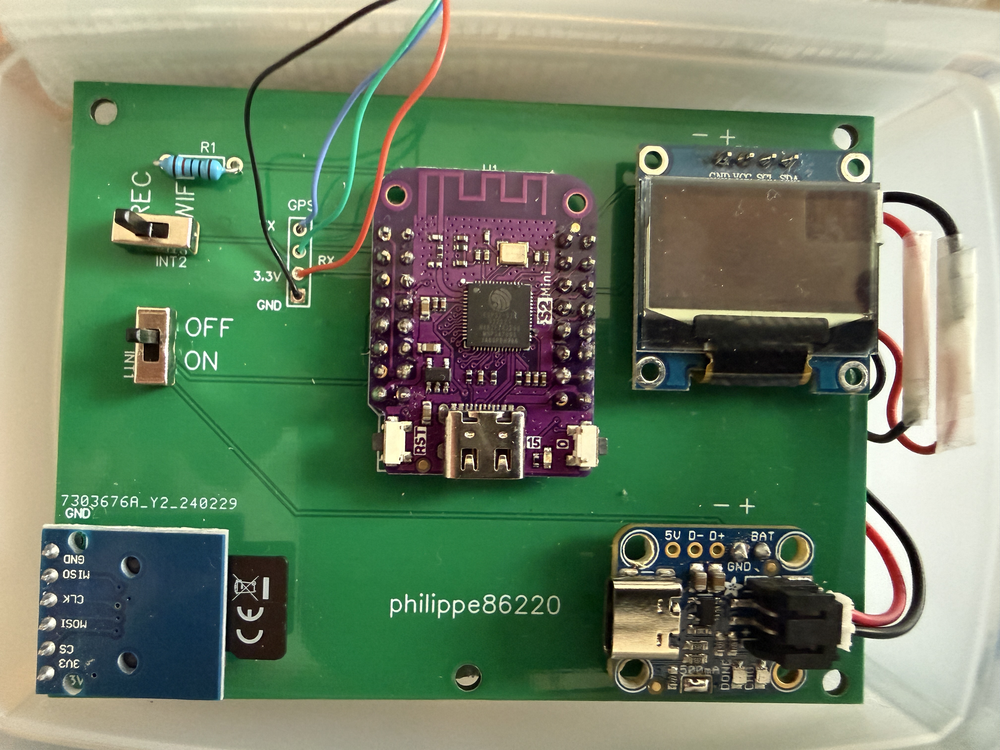
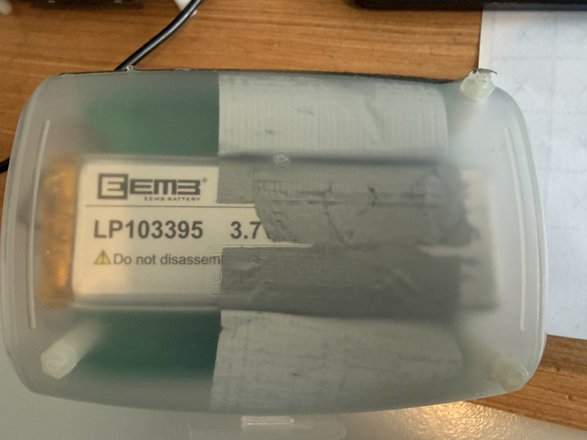
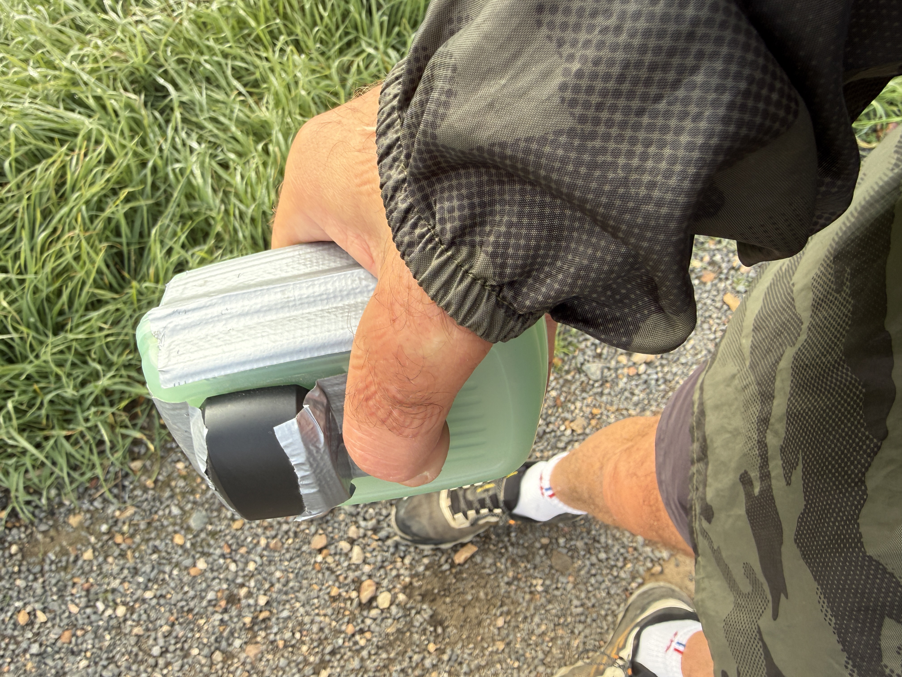
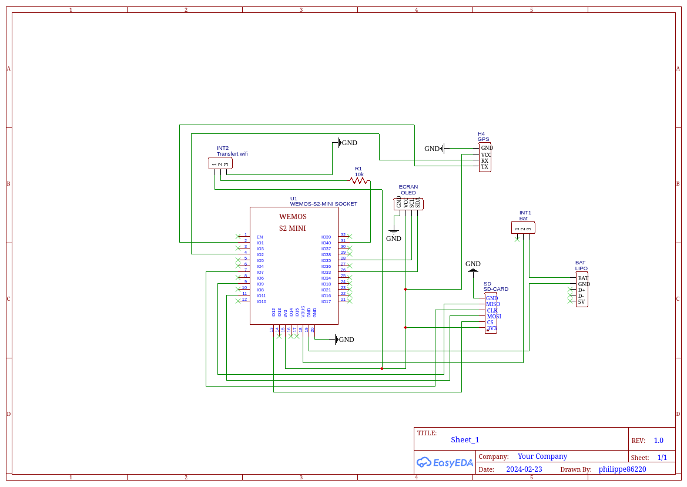
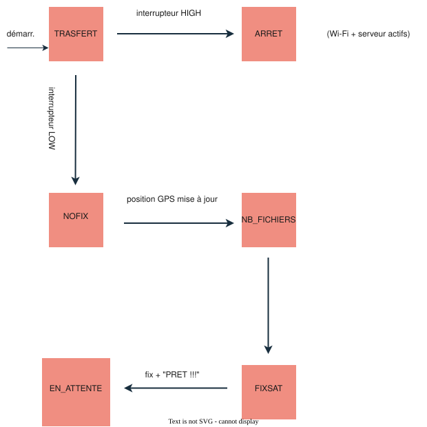

# GPS Logger → GPX Files (LOLIN S2 mini)

Standalone GPS track logger based on a **LOLIN (Wemos) S2 mini** (ESP32-S2) with a microSD card module.
It records the position every 1.5 seconds in **GPX 1.1** files on the SD card, displays elapsed time on an OLED screen, and lets you **retrieve the latest track over Wi-Fi** using a small web server.

---

## Some photos







---

## Features

- Records GPS points (latitude, longitude, altitude, time, satellite count, HDOP) in a `trackXXX.gpx` file.
- Starts/stops recording with a button (the board's built-in `0` button).
- OLED display: shows `PRET !!!` when a GPS fix is obtained, then elapsed time (hours, minutes, seconds) and the current filename.
- **Two modes** selected by a switch: **GPS** mode (recording) and **transfer** mode (Wi-Fi + web server).
- Automatic circular rotation: up to **200 files** (`track000.gpx` through `track199.gpx`); the oldest is then replaced.
- Automatic handling of French daylight saving time (calculated without an RTC module).
- Static IP address in transfer mode.

---

## Hardware

| Component | Details |
|---|---|
| Board | LOLIN S2 mini V1.0.0 (ESP32-S2) |
| Storage | microSD card reader |
| GPS | Serial GPS module (NMEA, 9600 baud) |
| Display | SSD1306 OLED 128×64, I2C, address `0x3C` |
| Button | Built-in board button, labeled `0` |
| REC / WIFI switch | Two-position slide switch + 10 kΩ resistor |
| ON / OFF switch | Two-position slide switch |
| LiPo charging module | Adafruit Micro-Lipo Charger for LiPoly Batt with USB Type C Jack (Warning: the battery connector polarity may sometimes be reversed) |
| LiPo battery | 3.7 V – 3700 mAh – 13.7 Wh |

---

## Schematic



---

## PCB fabrication

The `GERBER` directory contains manufacturing files for two PCB versions designed in 2024.

| Version | Dimensions |
|---|---|
| February 2024 | 94.36 × 69.72 mm |
| March 2024 | 90.17 × 61.60 mm |

The ZIP archives can be sent directly to a PCB manufacturer to reproduce the boards.

These files are for manufacturing bare PCBs. The electronic components must then be fitted and soldered.

---

## Wiring and pin assignments

### Board pins

```text
GPS serial (SoftwareSerial): RX = GPIO 1, TX = GPIO 2

I2C (OLED display) : SDA = GPIO 33, SCL = GPIO 35

SPI (SD card)      : SS (CS) = GPIO 12
                     MOSI    = GPIO 11
                     MISO    = GPIO 9
                     SCK     = GPIO 7

Start/stop button  : GPIO 0  (INPUT_PULLUP, active LOW)
Mode switch        : GPIO 40 (INPUT)
```

### Mode switch (GPIO 40)

Switch `INT2` is an SPDT switch. Its common terminal is connected to GPIO 40 through a 10 kΩ series resistor (`R1`). Its other two terminals are connected to GND and 3.3 V, respectively.

```text
                ┌── 3.3 V
INT2 (SPDT) ────┤
    common      └── GND
       │
       R1 10 kΩ (series, protection)
       │
     GPIO 40
```

| GPIO 40 state | Switch position / mode |
|---|---|
| `HIGH` (3.3 V side) | **Transfer**: Wi-Fi enabled, web server running |
| `LOW` (GND side) | **GPS**: Wi-Fi disabled, recording available |

### GPS

Connect the GPS module's **TX** to the board's **RX (GPIO 1)**, and the module's **RX** to **GPIO 2** (not actually used, as the board only listens to the GPS).

---

## Required libraries

Install these in the Arduino IDE (Library Manager or ZIP archive):

- `WiFi` (included with ESP32 board support)
- [`ESPAsyncWebServer`](https://github.com/me-no-dev/ESPAsyncWebServer) (and its `AsyncTCP` dependency)
- `SoftwareSerial` (ESP32 version, e.g. *EspSoftwareSerial*)
- [`TinyGPSPlus`](https://github.com/mikalhart/TinyGPSPlus)
- `SD` (included with ESP32 board support)
- `Wire` (included)
- `Adafruit GFX Library`
- `Adafruit SSD1306`

Select **LOLIN S2 Mini** as the board (Espressif's `esp32` package).

---

## Usage

### Record a track

1. Set switch `INT2` to **REC** (GPIO 40 LOW).
2. Power on the board by setting switch `INT1` to **ON**.
3. Wait for a GPS fix: the display shows **PRET !!!** (ready).
4. Press the board's `0` button: recording starts. The display shows elapsed time and the filename (e.g. `/track012.gpx`).
5. Press the `0` button again: recording stops, the GPX file is closed properly, and the display shows **STOP ...**.

You can start another recording (in a new file) without restarting, but it is preferable to turn the board off by setting `INT1` to **OFF**. Only the most recent GPX file is available for download through the web server; however, you can remove the SD card to retrieve several tracks.

### Retrieve the latest track

1. Set the switch to **transfer** mode (GPIO 40 HIGH) **before powering on** (the switch state is read only at startup).
2. Power on the board by setting switch `INT1` to **ON**.
3. The board connects to Wi-Fi and serves the latest track at the configured IP address (see *Web server*).
4. On Linux or macOS, open a terminal and enter:
   `curl -o trace.gpx http://IP_STATIQUE/interpret`
   On Windows:
   `curl.exe -o trace.gpx http://ADRESSE_DE_LA_CARTE/interpret`
5. The GPX track is saved as `trace.gpx` in the terminal's current directory. Each subsequent download using the same command overwrites that local file.
6. You can import the file into an online sports application such as [Decathlon Coach](https://www.decathloncoach.com/fr-fr/portal/feed).

---

## How the program works

The program is organized around a **state machine** (`etatCourant`):



| State | Purpose |
|---|---|
| `TRANSFERT` | Initial state: reads the switch and selects the mode. |
| `ARRET` | Transfer mode: the server keeps running; nothing else needs to be done in `loop()`. |
| `NOFIX` | Waits for the first valid GPS position. |
| `NB_FICHIERS` | Checks whether `/nb.txt` exists and retrieves the last recorded file number when rotation is active. |
| `FIXSAT` | Displays `PRET !!!` once a fix is obtained and calculates the daylight saving time offset (`heures`). |
| `EN_ATTENTE` | Main state: handles the button, point recording, and file closure. |

### Recording loop (`EN_ATTENTE`)

- **Button pressed** (100 ms debouncing before and after, with a wait for release):
  - If recording is stopped: selects an available filename (`/trackXXX.gpx`), resets the timer, writes the GPX header, and sets `b_gpx_tracking = true`.
  - Otherwise: sets `b_gpx_tracking = false` (stop requested).
- **Every 1.5 seconds** (if GPS serial data is available):
  - If recording is active and the position has been updated → updates the display and appends a `<trkpt>`.
  - If recording has just been stopped → writes the end of the GPX file (`completeGPX()`) and, if rotation is active, updates `/nb.txt`.

GPS sentences are decoded (`gps.encode`) only when the switch is in GPS mode.

---

## GPX file format

Each file follows the GPX 1.1 structure:

```xml
<?xml version="1.0" encoding="UTF-8" standalone="no" ?>
<gpx version="1.1" creator="P. COSTES" xmlns="http://www.topografix.com/GPX/1/1" ...>
  <metadata>
    <name>/track012.gpx</name>
    <desc>Wemos S2 mini - GPS_S2_ mini</desc>
    <author><name>P. COSTES</name></author>
  </metadata>
  <trk>
    <name>/track012.gpx</name>
    <desc>Wemos S2 mini</desc>
    <trkseg>
      <trkpt lat="48.12345678" lon="2.12345678">
        <ele>85.20</ele>
        <time>2026-11-09T10:30:20+01:00</time>
        <sat>8</sat>
        <hdop>110</hdop>
      </trkpt>
      ...
    </trkseg>
  </trk>
</gpx>
```

- `lat` / `lon`: 8 decimal places.
- `ele`: altitude in meters.
- `time`: date and time derived from GPS data, **local time** (UTC + `heures`).
- `sat`: number of satellites.
- `hdop`: raw horizontal dilution of precision value provided by TinyGPSPlus (value × 100).

Points are added one at a time (open with `FILE_APPEND`, write, close). This limits data loss if power is interrupted. However, a power cut during recording can leave the GPX file incomplete, particularly because the closing XML tags may be missing.

---

## GPX file management and rotation

The logger keeps a maximum of **200 GPX files** on the SD card, numbered `track000.gpx` through `track199.gpx`.

Once this limit is reached, new recordings progressively replace the oldest files using **circular rotation**.

### 1. File creation

On an initially empty SD card, files are created in sequence:

`track000.gpx` → `track001.gpx` → ... → `track199.gpx`

Each new recording uses the first available number.

Until the 200-file limit is reached, no GPX files are deleted.

### 2. File rotation

Once all 200 slots are occupied, the next recording causes:

1. Deletion of `track000.gpx`, the oldest file.
2. Creation of a new `track000.gpx`.
3. Activation of circular rotation.

Subsequent recordings replace, in order:

`track001.gpx` → `track002.gpx` → ... → `track199.gpx`

After `track199.gpx` has been replaced, the program returns to `track000.gpx`.

**Under normal operating conditions, the number of GPX files on the SD card therefore never exceeds 200.**

### 3. Purpose of `nb.txt`

The `/nb.txt` file stores the number of the most recent recording when rotation is active.

It works as follows:

- **File absent:** the program searches for the first available GPX file number.
- **File present:** the program reads the last recorded number so that rotation can continue from that point.

The `nb.txt` file is created when rotation becomes active, then updated whenever a new recording is closed.

This makes it possible to recover the rotation position after a power interruption.

### 4. Handling restarts

The logger can be turned off after each session and restarted later. The `/nb.txt` file preserves the rotation state once rotation is active.

### Before the first rotation (no `/nb.txt`)

- The program scans the `trackXXX.gpx` filenames on the card and creates the first available number.
- If all 200 files already exist, it activates rotation: it deletes `track000.gpx`, recreates it, and sets `nbAtteint` to true.
- At the end of this session, `/nb.txt` is created with the value `0`.

### After rotation has started (`/nb.txt` exists)

`/nb.txt` contains the number of the **last file recorded** (not the oldest). At startup, the program reads this number, X. For each new session:

1. It deletes file **X + 1** (modulo 200). During rotation, this is the oldest file on the card.
2. It recreates that file and records the track in it: the card therefore retains 200 files.
3. When recording is stopped with the button, it writes the new number to `/nb.txt`.

Example:

| Step | `nb.txt` | File deleted and recreated |
|---|---|---|
| Next session | 41 | track042 |
| Next session | 42 | track043 |
| ... | ... | ... |
| Session when `nb.txt` = 199 | 199, deleted | track000 |
| End of that session | 0 | |

When X equals 199, the program deletes `/nb.txt`, starts again with `track000.gpx`, and writes `0` back to `/nb.txt` at the end of the session.

### Important

`/nb.txt` is updated **only when recording is stopped using the button**, not when the power is switched off.

---

### 5. File transfer

In Wi-Fi mode, the program identifies the most recently recorded GPX file:

- If `/nb.txt` exists, its contents directly identify the last file number.
- Otherwise, the program searches for the last file in the initial sequence.

The selected file is then made available through the logger's web server.

### Conditions of use

This mechanism assumes that individual GPX files are not manually deleted or renamed on the SD card.

To reset numbering completely, delete all `trackXXX.gpx` files as well as `/nb.txt`.

On the next startup, recording begins again at `track000.gpx`.

---

## Web server

In transfer mode, the board connects to Wi-Fi using the static IP address and starts an `AsyncWebServer` on **port 80**:

| URL | Behavior |
|---|---|
| `http://IP_STATIQUE/` | **Downloads** the latest track (`Content-Disposition: attachment`) |
| `http://IP_STATIQUE/interpret` | Serves the track as `text/xml` **without** forcing a download (display or processing by an application) |

---

## `initReseauWifi()` function: Wi-Fi, static IP, and web server

This function is called **only once**, at startup, when the switch is in **transfer** position (GPIO 40 HIGH). It selects the file to serve (the most recent recording), connects the board to Wi-Fi, displays the status on the OLED, and starts the web server used to retrieve the latest GPX track.

---

## 1. Where it is called in the program

```cpp
case TRANSFERT:
  if (digitalRead(pinInterrupteur) == HIGH) {
    initReseauWifi();
    etatCourant = ARRET;      // the state machine remains in this state afterwards
  }
```

- After the call, the state machine enters `ARRET`: the server runs in the background (asynchronous library), and `loop()` has nothing further to do.
- To exit this mode, turn off the power and set the switch back to GPS mode.

---

## 2. Step-by-step operation

### Step 1: select the file to serve

```cpp
if (isnNbTxt()) {
  const char* s = fichierLePlusVieux_L();
  fileID = s ? atoi(s) : 0;
  sprintf(GPXFILE, "/track%03d.gpx", fileID);
}
else if (!isnNbTxt()) {
  while (1) {
    sprintf(GPXFILE, "/track%03d.gpx", fileID);
    if (!SD.exists(GPXFILE)) break;
    else fileID++;
  }
  sprintf(GPXFILE, "/track%03d.gpx", fileID - 1);
}
```

| Situation | File served |
|---|---|
| `nb.txt` exists (rotation active) | The number read from `nb.txt`, i.e. the most recently recorded file |
| `nb.txt` does not exist (first cycle) | The last existing file: find the first free number, then subtract 1 |

The result is stored in `GPXFILE`, which is used by the server routes below.

### Step 2: configure Wi-Fi

```cpp
WiFi.persistent(false);
WiFi.mode(WIFI_STA);
bool ipStatiqueOK = WiFi.config(local_IP, gateway, subnet);
WiFi.begin(ssid, password);
```

- **`WiFi.persistent(false)`**: prevents the ESP32 from writing the network name and password to flash memory on every connection.
- **`WiFi.mode(WIFI_STA)`**: puts the board in station mode (see the table below).
- **`WiFi.config(...)`**: requests a fixed IP address. It must be called **before** `WiFi.begin()`. Its result (`true` or `false`) is stored in `ipStatiqueOK`.
- **`WiFi.begin(...)`**: starts the network connection.

### Step 3: wait for the connection (up to 20 seconds)

```cpp
unsigned long debut = millis();
while (WiFi.status() != WL_CONNECTED && millis() - debut < 20000) {
  delay(500);
}
```

Connecting takes a few seconds. Without this wait, the following test would always be negative. The loop ends as soon as the board connects, or after 20 seconds.

### Step 4: check the result and display the status

| Display | Meaning |
|---|---|
| `WIFI...` | Connection in progress |
| `WIFI KO` | No connection after 20 seconds. The function ends with `return`: **the server is not started** |
| `WIFI OK` + 3 addresses | Connected using the requested static IP address |
| `IP STAT KO` + 3 addresses | Connected, but `WiFi.config()` failed: the board obtained an address through DHCP |

The three address lines show the board's IP address, the gateway (router), and the subnet mask.

### Step 5: start the web server

```cpp
server.on("/", HTTP_GET, [](AsyncWebServerRequest * request) {
  request->send(SD, GPXFILE, "text/xml", true);
});
server.on("/interpret", HTTP_GET, [](AsyncWebServerRequest * request) {
  request->send(SD, GPXFILE, "text/xml", false);
});
server.begin();
```

| Address | Behavior |
|---|---|
| `/` | Downloads the file (forced download) |
| `/interpret` | Serves the file as text, without forcing a download |

---

## 3. ESP32 Wi-Fi modes

| Mode | Purpose |
|---|---|
| `WIFI_STA` | **Station**: the board connects to your router, like a phone. This is the mode used here |
| `WIFI_AP` | Access point: the board creates its own network |
| `WIFI_AP_STA` | Both modes at once |
| `WIFI_OFF` | Wi-Fi disabled |

`WiFi.begin()` already switches the board to station mode. The `WiFi.mode(WIFI_STA)` line simply makes the sequence explicit: the mode is set before `WiFi.config()`. It has no adverse effect.

---

## 4. OLED display

The display resolution is 128 × 64 pixels.

- **`setTextSize(2)`**: 12 pixels per character, allowing a maximum of **10 characters per line**. Messages must remain short (`IP STAT KO` is exactly 10 characters).
- **`setTextSize(1, 2)`**: narrow characters (6 pixels) but twice as tall (16 pixels). An address such as `192.168.1.254` fits on one line.
- Four 16-pixel lines fill the 64-pixel display, with no margin.
- The text size is reset to 2 at the end so that other display operations are unaffected.

---

## 5. Retrieve the track

1. Set the switch to transfer mode, then power on the board.
2. Wait for the display to show `WIFI OK` (or `IP STAT KO`) together with the board's IP address.
3. Retrieve the GPX file.

### From a terminal

Both addresses let you retrieve **exactly the same GPX file**.

The `-o` option tells `curl` to save the file as `trace.gpx` in the current directory.

**First option:**

```bash
curl -o trace.gpx http://ADRESSE_DE_LA_CARTE/
```

**Second option:**

```bash
curl -o trace.gpx http://ADRESSE_DE_LA_CARTE/interpret
```

Both commands produce the same result: the GPX file is saved locally.

**Commands by operating system:**

| System | Command |
|---|---|
| Linux | `curl -o trace.gpx http://ADRESSE_DE_LA_CARTE/` |
| macOS | `curl -o trace.gpx http://ADRESSE_DE_LA_CARTE/` |
| Windows 10/11 | `curl.exe -o trace.gpx http://ADRESSE_DE_LA_CARTE/` |

On Windows, using `curl.exe` also avoids confusion with the `curl` alias in some versions of PowerShell.

### From a web browser

The two addresses behave differently:

| Address | Result |
|---|---|
| `http://ADRESSE_DE_LA_CARTE/interpret` | Displays the GPX file's XML content in the browser, if supported. |
| `http://ADRESSE_DE_LA_CARTE/` | Triggers a GPX file download, usually into the Downloads folder. |

**Note:** unlike a web browser, `curl` does not use the HTTP `Content-Disposition` header to decide automatically whether to save the file. The `-o` option controls saving.

### Which IP address should you use?

In all cases, use **the IP address shown on the OLED display**: this is the address the board actually obtained when connecting to Wi-Fi.

If the display shows `IP STAT KO`, the connection may still work using an IP address assigned automatically by the router.

---

## Daylight saving time / standard time

The `RTCete()` function determines whether a UTC date provided by the GPS falls within daylight saving time in metropolitan France, **without an RTC module**:

- Switch to daylight saving time: last Sunday in March, 01:00 UTC.
- Return to standard time: last Sunday in October, 01:00 UTC.
- The time offset is calculated when a GPS fix is obtained and remains constant throughout the session.

The last Sunday is calculated using an arithmetic formula based on the two-digit year. The function returns `true` (summer, +2 hours) or `false` (winter, +1 hour). The result is stored in `heures` and added to UTC when generating each `<time>` value.

---

## Function reference

| Function | Purpose |
|---|---|
| `setup()` | Initializes the GPS (9600 baud), OLED display, SD card, and inputs, then sets the state machine to `TRANSFERT`. |
| `loop()` | Reads GPS data (GPS mode) and runs the state machine. |
| `initGPX()` | Creates the GPX file and writes its header (XML, metadata, opening `<trkseg>`). |
| `addTrackpt()` | Appends a `<trkpt>` containing position, altitude, time, satellite count, and HDOP. |
| `completeGPX()` | Displays `STOP ...` and closes `</trkseg>`, `</trk>`, and `</gpx>`. |
| `initReseauWifi()` | Selects the latest file, configures the static IP, connects to Wi-Fi, defines the routes, and starts the server. |
| `suppressionFichiers(int x)` | Deletes `/trackXXX.gpx` if it exists. |
| `isnNbTxt()` | Checks whether `/nb.txt` exists. |
| `fichierLePlusVieux_E(int nmr)` | Writes the number to `/nb.txt`. |
| `fichierLePlusVieux_L()` | Reads `/nb.txt` and returns its contents as a string (or `nullptr`). |
| `affiche()` | Updates the OLED: time elapsed since the start of the track and filename. |
| `RTCete(...)` | Returns `true` if the UTC date falls within French daylight saving time. |

---

## Author

**Philippe COSTES** (Philippe86220)

Author of the `RTCete(...)` function: @bricoleau — https://forum.arduino.cc/t/trouver-date-et-heure-changement-heure-ete-hiver/1250041/21

Explanation of this function: https://forum.arduino.cc/t/jour-de-la-semaine-en-fonction-de-yy-mm-dd/1284802

## Acknowledgements

Many thanks to **@j-m-l**, who guided me as I learned the basics of C++ and many other programming concepts.

In 2022, he helped guide me through the design of an early version of this GPS logger:

[GPS with GPX file creation — C-string version (French)](https://forum.arduino.cc/t/gps-avec-creation-de-fichiers-gpx-version-c-string/996413)

I am especially grateful for his patience, availability, and outstanding teaching skills.

I would also like to thank the other members of the French-speaking Arduino forum who have helped me improve over the years.

Finally, thanks to **ChatGPT (OpenAI)** for its assistance with code analysis, technical troubleshooting, and the writing of this documentation.
